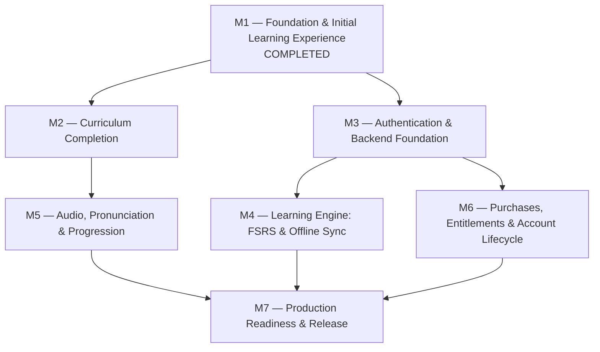

# Proposed MVP Milestones Roadmap

**Repository:** [PadoSensei/bjj-lang](https://github.com/PadoSensei/bjj-lang/)
**Baseline Document:** `docs/product/MVP_SCOPE.md`
**Companion Audit:** `docs/roadmap/P0_ROADMAP_AUDIT.md`
**Status:** Proposal (Pending Administrative Review)

---

## 1. Roadmap Architecture & Planning Tracks

To balance learner value, technical prerequisites, and dependency risks, the MVP roadmap is organized across **six distinct planning tracks**:

1. **Curriculum:** Courses, units, lessons, contextual examples, and content completeness. Content authoring is decoupled from infrastructure so curriculum development is never blocked by backend readiness.
2. **Learning Experience:** Interactive exercise runners, flashcard review UI, audio pronunciation, and belt progression.
3. **Platform Foundation:** Authentication, Supabase infrastructure, user account lifecycle, and age verification.
4. **Learning Infrastructure:** Real FSRS spaced repetition algorithms, offline mutation queues, and idempotent cloud event synchronization.
5. **Business:** In-app purchases, entitlement validation, paywalls, and cross-device purchase restoration.
6. **Release Readiness:** Security & privacy audit, self-service account deletion, error monitoring, legal disclosures, and production app store deployments.

---

## 2. Milestone Sequence Overview

| Milestone | Title | Primary Planning Track | Target P0 Scope | Status |
|:---:|---|---|---|:---:|
| **M1** | Foundation & Initial Learning Experience | Learning Experience / Infrastructure | P0 #1, #2, #5, #6 (local), #8 (local) | **Completed** |
| **M2** | Curriculum Completion | Curriculum | P0 #4 | **Proposed** |
| **M3** | Authentication & Backend Foundation | Platform Foundation | P0 #3, #6 (cloud schema) | **Proposed** |
| **M4** | Learning Engine: FSRS & Offline Sync | Learning Infrastructure | P0 #6, #7, #8 (engine), #11 | **Proposed** |
| **M5** | Audio, Pronunciation & Progression | Learning Experience | P0 #9, #10 | **Proposed** |
| **M6** | Purchases, Entitlements & Lifecycle | Business / Platform Foundation | P0 #12, #13 | **Proposed** |
| **M7** | Production Readiness & Release | Release Readiness | P0 #14 | **Proposed** |

---

## 3. Milestone Specifications

---

### Milestone 1: Foundation & Initial Learning Experience (Completed)
- **Objective:** Establish the Expo application shell, reusable design system tokens, bidirectional course navigation, interactive lesson mechanics, local progress persistence, and a basic vocabulary review queue.
- **Included Requirements:**
  - P0 #1: Expo app shell and navigation
  - P0 #2: Onboarding and course direction
  - P0 #5: Lesson interaction and answer feedback
  - P0 #6: Separate learning state (local AsyncStorage partitioning)
  - P0 #8: Review queue and session completion (local heuristic queue)
- **Dependencies:** None.
- **Definition of Done:**
  - [x] Responsive app shell running on iOS, Android, and Web (`dist/`).
  - [x] Course direction switcher with isolated state for `pt-BR->en` and `en->pt-BR`.
  - [x] Multiple-choice and translation-recall exercise runners with feedback and score calculation.
  - [x] Local review queue with card flip, self-rating, and session completion screen.
  - [x] Comprehensive test suite (100+ tests passing) and automated CI pipeline.

---

### Milestone 2: Curriculum Completion
- **Objective:** Complete the published curriculum for all units and lessons across both course directions (`pt-BR->en` and `en->pt-BR`), authoring high-quality BJJ mat vocabulary, contextual coaching explanations, and exercise pairings.
- **Included Requirements:**
  - P0 #4: Published course, units, lessons, and structured content
- **Dependencies:** Milestone 1 foundation.
- **Track:** Curriculum.
- **Key Deliverables:**
  - Implement missing Unit 2 positions lesson (`lesson-2-2`) and Unit 3 submissions lessons (`lesson-3-1`, `lesson-3-2`) in `src/data/mockLessons.ts`.
  - Author bidirectional translations, pronunciation hints, contextual academy usage, and exercise sets for all lessons.
  - Update `MOCK_COURSES` in `src/data/mockCourseData.ts` to reflect the full 3-unit syllabus.
  - Content schema validation test suite ensuring every vocabulary item has unique IDs, non-empty examples, and valid exercise references.
- **Definition of Done:**
  - [ ] 100% of planned lessons in Units 1, 2, and 3 are implemented and navigable in both course directions.
  - [ ] Automated content integrity tests pass with zero missing lesson references or broken exercise indices.
  - [ ] Visual verification screenshots captured for each newly added lesson across desktop and mobile viewports.

---

### Milestone 3: Authentication & Backend Foundation
- **Objective:** Establish the Supabase cloud backend foundation, integrating Supabase Auth with anonymous/guest mode, session management, user profile records, and age verification safeguards.
- **Included Requirements:**
  - P0 #3: Authentication/account flow appropriate to age/privacy requirements
  - P0 #6: Cloud user state schema (preparation for remote sync)
- **Dependencies:** Milestone 1 foundation.
- **Track:** Platform Foundation.
- **Key Deliverables:**
  - Install and configure `@supabase/supabase-js` with secure credential storage (`expo-secure-store`).
  - Implement anonymous/guest learning session by default (no friction for new students).
  - Build optional sign-up/sign-in screens (email/magic link) with age-gate validation for COPPA/GDPR compliance.
  - Build seamless guest-to-authenticated account conversion preserving all existing local progress.
  - Database migrations for `profiles` table with strict Row Level Security (RLS) policies.
- **Definition of Done:**
  - [ ] App launches in guest mode without blocking the user with authentication modals.
  - [ ] Users can register or log in, receiving a persistent JWT stored securely.
  - [ ] Local progress created in guest mode is automatically linked to the user account upon sign-in.
  - [ ] Unit and component tests verify auth state transitions, error alerts, and token refresh.

---

### Milestone 4: Learning Engine: FSRS & Offline Synchronization
- **Objective:** Replace the primitive heuristic scheduler with the production Free Spaced Repetition Scheduler (FSRS) algorithm, and implement offline-first review session handling with idempotent cloud mutation synchronization.
- **Included Requirements:**
  - P0 #6: Separate learning state by concept, course, and direction (cloud sync)
  - P0 #7: FSRS scheduling integration with tests
  - P0 #8: Review queue and session completion (engine integration)
  - P0 #11: Offline lesson/review capability and safe event sync
- **Dependencies:** Milestone 2 (Curriculum), Milestone 3 (Backend & Auth Foundation).
- **Track:** Learning Infrastructure.
- **Key Deliverables:**
  - Integrate a verified FSRS implementation (`ts-fsrs`) behind a clean `SpacedRepetitionScheduler` interface.
  - Extend review outcomes to standard FSRS rating levels (Again, Hard, Good, Easy) with card stability and difficulty tracking.
  - Implement network connectivity listener (`@react-native-community/netinfo`).
  - Implement an append-only offline mutation outbox for completed reviews and lesson completions.
  - Build bidirectional sync worker: pushes local review events to Supabase and pulls remote state changes with safe timestamp conflict resolution.
- **Definition of Done:**
  - [ ] Comprehensive unit tests verify FSRS scheduling mathematics, interval bounds, and deterministic outcomes against reference test vectors.
  - [ ] Full review sessions can be conducted in airplane mode with zero errors.
  - [ ] Restoring network connectivity drains the outbox to Supabase idempotently without data loss or duplicate records.

---

### Milestone 5: Audio, Pronunciation & Progression
- **Objective:** Integrate native audio playback for vocabulary and dialogue, implement XP rewards and streak tracking, and tie belt-inspired milestones directly to user learning achievements.
- **Included Requirements:**
  - P0 #9: Progress, belt-inspired milestones, and XP
  - P0 #10: Audio playback for selected content
- **Dependencies:** Milestone 2 (Curriculum), Milestone 4 (Learning Engine).
- **Track:** Learning Experience.
- **Key Deliverables:**
  - Install `expo-av` (or `expo-audio`) and build a reusable `AudioPlayerButton` component with playback state, caching, and fallback handling.
  - Connect pronunciation audio assets/CDN URLs to vocabulary models in both Portuguese and English.
  - Implement XP (Experience Points) accumulation engine awarding points for lesson steps, perfect recall, and review completions.
  - Build belt promotion engine calculating current learner rank (White → Blue → Purple → Brown → Black) and stripe progress.
  - Add celebration modals / milestone feedback animations upon completing units or earning stripes.
- **Definition of Done:**
  - [ ] Tapping the audio button plays clear audio for supported vocabulary items with visual playing indicators.
  - [ ] Offline audio playback succeeds for previously cached lessons.
  - [ ] XP and belt rank update dynamically in the learner's profile and persist across app reloads.
  - [ ] Unit and component tests verify audio failure handling and XP mathematical formulas.

---

### Milestone 6: Purchases, Entitlements & Account Lifecycle
- **Objective:** Implement in-app purchase infrastructure for the commercial English → Brazilian Portuguese course (while strictly keeping Portuguese → English 100% free), purchase restoration, and self-service account deletion.
- **Included Requirements:**
  - P0 #12: Purchase and entitlement flow for paid course, including restore
  - P0 #13: Account deletion and privacy disclosures
- **Dependencies:** Milestone 3 (Platform Foundation / Supabase Auth).
- **Track:** Business / Platform Foundation.
- **Key Deliverables:**
  - Integrate In-App Purchases SDK (`react-native-purchases` / RevenueCat) for App Store and Google Play.
  - Implement course entitlement gating: `pt-BR->en` remains permanently unlocked; `en->pt-BR` offers free preview (Unit 1) with paywall gating for subsequent units.
  - Build "Restore Purchases" button with receipt validation and error feedback.
  - Implement self-service "Delete Account" flow in settings with two-step confirmation.
  - Build Supabase database trigger / RPC function to permanently purge user profile, progress, reviews, and sync records upon account deletion.
  - Add in-app Privacy Policy, Terms of Service, and child safety disclosure views.
- **Definition of Done:**
  - [ ] `pt-BR->en` course is verified completely free with zero monetization hurdles.
  - [ ] `en->pt-BR` course paywall displays correct localized store pricing and handles purchase/restore flows in sandbox test environments.
  - [ ] Account deletion completely purges remote user data and resets local state to clean guest status.
  - [ ] Privacy disclosures are accessible offline and adhere to App Store Review Guideline 5.1.1(v).

---

### Milestone 7: Production Readiness & Release
- **Objective:** Deploy crash monitoring, privacy-reviewed telemetry, automated mobile build pipelines (EAS), and prepare production release candidate builds for App Store and Google Play review.
- **Included Requirements:**
  - P0 #14: Error monitoring, analytics with privacy review, release process
- **Dependencies:** Milestones 1 through 6.
- **Track:** Release Readiness.
- **Key Deliverables:**
  - Integrate Sentry crash reporting (`@sentry/react-native`) configured with privacy filters that strip sensitive user inputs.
  - Implement privacy-compliant telemetry tracking only core milestone events (lesson completed, review finished) with child-safe defaults.
  - Configure Expo Application Services (`eas.json`) for automated iOS and Android production builds.
  - Conduct full pre-flight release checklist: bundle size audit, deep link verification, privacy label compliance, and store metadata review.
- **Definition of Done:**
  - [ ] Sentry captures unhandled runtime errors in staging/production builds with verified sourcemaps.
  - [ ] EAS production builds generate passing `.ipa` and `.aab` artifacts.
  - [ ] Release candidate passes all automated checks: `pnpm lint`, `pnpm typecheck`, `pnpm test`, `pnpm run doctor`, and `pnpm run build:web`.
  - [ ] Documentation updated with operational runbooks for emergency releases and rollback procedures.

---

## 4. Governance & Implementation Guidelines

1. **Sequential Progression:** Milestones M2 and M3 can progress in parallel across the Curriculum and Platform tracks. M4 and M5 depend on M2 and M3. M7 is the final release gate.
2. **Issue Hygiene:** No GitHub implementation issues or milestones should be created or reassigned until this proposed sequence is explicitly approved by project leadership.
3. **Traceability:** When implementation issues are created, every issue must link back to its corresponding P0 requirement ID and proposed milestone definition in this document.
